# 💎 Awesome Web3 Wallet & Crypto Asset Management 🚀

  
  
  
  

  <strong>A curated directory and ecosystem overview of top SaaS platforms, enterprise custody solutions, and open-source Web3 wallets, self-custody key managers, hardware suites, and decentralized crypto asset management tools. 🛡️⚡</strong>

  Focused on self-custody, MPC key management, multi-chain asset aggregation, EVM &amp; Solana dApp browsing, Account Abstraction (ERC-4337), hardware firmware, and DeFi portfolio analytics.

---

## 📑 Table of Contents

- [📊 Sector Overview & Market Dynamics](#-sector-overview--market-dynamics)
- [🏢 SaaS & Hosted Platforms](#-saas--hosted-platforms)
- [💻 Open-Source GitHub Projects](#-open-source-github-projects)
- [🎯 Key Selection Criteria](#-key-selection-criteria)
- [🤝 How to Contribute](#-how-to-contribute)
- [💖 Support](#-support)
- [📈 Star History](#-star-history)
- [⚠️ Disclaimer](#-disclaimer)

---

## 📊 Sector Overview & Market Dynamics

The global crypto wallet and digital asset management market was valued at **$13.5 billion to $15.5 billion in 2025–2026** and is projected to surpass **$65 billion by 2030**, expanding at a Compound Annual Growth Rate (CAGR) of approximately **25%–28%** 📈. 

From a structural perspective, the market is **moderately concentrated at the infrastructure layer yet highly fragmented at the application layer** 🌐:
- **📱 Application & Retail Layer (Fragmented):** Hundreds of independent consumer browser extensions, smart-contract wallets, and mobile clients compete fiercely with zero barrier to entry for end users, preventing a single "winner-take-all" outcome across multi-chain ecosystems (EVM, Solana, Bitcoin, Cosmos).
- **🔒 Custodial & Cold-Storage Layer (Concentrated / Oligopoly):** Institutional custody is tightly concentrated among regulated MPC powerhouses like Fireblocks and BitGo, while consumer hardware cold storage remains heavily consolidated within a duopoly led by Ledger and Trezor.

---

## 🏢 SaaS & Hosted Platforms

The following hosted platforms and enterprise SaaS solutions provide turnkey custody, multi-exchange portfolio aggregation, and non-custodial Web3 management. They are sorted in descending order by enterprise market valuation or annual company revenue 💰.

| Platform | Company Valuation / Revenue | Starting Price | Free Tier Limit | Core Capabilities & Key Focus |
|:---|:---|:---|:---|:---|
| **[Coinbase Wallet](https://coinbase.com/wallet)** 🪙 | **$55B+ Market Cap** (Public: NASDAQ: COIN; $3.1B+ FY revenue) | $0 / Free (Standard retail network gas fees apply; 1% fiat on-ramp fee) | **Free forever plan**: Unlimited non-custodial wallet creation, passkey Smart Wallet onboarding, Base Layer-2 integration, and dApp browsing | Self-custody mobile app and browser extension featuring passkey onboarding, Base L2 integration, and smart account routing. |
| **[OKX Web3 Wallet](https://okx.com/web3)** 🌐 | **~$25B - $30B Est. Valuation** ($1B+ annual trading platform revenue) | $0 / Free (Standard blockchain network gas fees apply; 0% wallet platform fee) | **Free forever plan**: Unlimited multi-chain wallet accounts across 100+ blockchains, unlimited DEX aggregator routing, and NFT portfolio management | Non-custodial portal with native DEX aggregator, cross-chain bridge routing, 100+ chain support, and ERC-4337 Smart Account abstraction. |
| **[Fireblocks](https://fireblocks.com)** 🔥 | **$8.0B Valuation** (Series E funding round) | **$999 / month** (Essentials/Starter plan billed monthly or annually) | **Developer Sandbox**: Unlimited free testnet transactions, sandbox workspace, full API/SDK documentation access, and pre-production simulated vaults | Institutional MPC-CMP digital asset custody, treasury management, automated compliance screening, and enterprise DeFi access. |
| **[Phantom](https://phantom.app)** 👻 | **$1.2B Valuation** (Series B unicorn status) | $0 / Free (0.85% swap fee on in-wallet cross-token decentralized swaps) | **Free forever plan**: Unlimited Solana, Ethereum, Polygon, Bitcoin, and Sui addresses, watch-only accounts, and NFT collection tracking | High-performance multi-chain consumer crypto wallet with built-in biometric security, in-wallet token swaps, and NFT management. |
| **[BitGo](https://bitgo.com)** 🛡️ | **$1.75B Valuation** (Series C funding round) | **€2,500 setup fee + basis-point AUM fees** (~0.05%–0.25% AUM custodial rate with monthly minimums) | **Developer Hot Wallet Plan**: Free API sandbox access with up to $500 monthly developer credit for testnet simulation and basic multi-sig testing | Regulated institutional cold storage, qualified custody, automated multi-signature treasury policies, and staking infrastructure. |
| **[Exodus](https://exodus.com)** 🪐 | **~$350M Market Cap** (Public: OTCQX/NYSE: EXOD) | $0 / Free (In-wallet exchange routing spreads typically 1%–3% per transaction) | **Free forever plan**: Unlimited self-custody wallet addresses across 50+ blockchains, desktop/mobile multi-device sync, and Trezor hardware pairing | User-friendly multi-asset desktop, mobile, and Web3 browser wallet featuring portfolio charts, built-in exchange aggregators, and Trezor hardware pairing. |
| **[Zerion](https://zerion.io)** 🦄 | **~$130M Valuation** (Series B funding round) | **$0 / Free** for core wallet (0.5% swap fee on in-wallet decentralized aggregation) | **Free forever plan**: Unlimited wallet tracking, real-time multi-chain portfolio analytics, and gasless EVM swaps | Smart Web3 wallet and DeFi portfolio dashboard offering real-time PnL tracking, multi-chain position aggregation, and Zerion DNA perks. |
| **[CoinStats](https://coinstats.app)** 📊 | **~$50M Valuation** ($8M+ Series A funding round) | **$13.99 / month** (billed annually at $167.88/yr; or $19.99 billed monthly) | **Free forever plan**: Up to 10 connected portfolios/wallets, 20,000 transaction history syncing, and basic price alert monitoring | Cloud-synced crypto portfolio manager aggregating balances across 300+ wallets and exchanges with automated tax reporting and profit heatmaps. |
| **[DeBank](https://debank.com)** 🏦 | **~$40M - $50M Valuation** ($25M funding led by Sequoia China) | $0 / Free (Optional Web3 messaging pay-per-message model starting at $0.10/msg) | **Free forever plan**: Unlimited EVM address tracking across 70+ chains, approval security auditing, and DeFi protocol breakdown | Multi-chain DeFi balance tracker, token allowance security auditor, and social Web3 messaging protocol tracking protocol liquidity. |
| **[Zapper](https://zapper.xyz)** ⚡ | **~$35M - $45M Valuation** ($17M funding led by Framework Ventures) | $0 / Free (Standard decentralized DEX liquidity routing fees apply) | **Free forever plan**: Unlimited wallet address tracking, NFT portfolio valuation, and curated on-chain DeFi exploration | Web3 social explorer and on-chain intelligence dashboard tracking liquidity pools, NFT collections, DAO governance, and whale wallets. |

---

## 💻 Open-Source GitHub Projects

Curated open-source software, desktop clients, mobile wallets, developer SDKs, and self-hosted wealth trackers. Repositories are ranked in descending order by GitHub stargazers ⭐.

| Project & Repository | GitHub Stars | License | Primary Tech Stack | Description |
|:---|:---:|:---:|:---:|:---|
| **[MetaMask Extension](https://github.com/MetaMask/metamask-extension)** 🦊 |  | Source-available | JavaScript / React | Flagship browser extension wallet for Ethereum and EVM-compatible networks with hardware keyring integration. |
| **[Ghostfolio](https://github.com/ghostfolio/ghostfolio)** 👻 |  | AGPL-3.0 | TypeScript / NestJS / Angular | Self-hosted wealth and asset management dashboard supporting cryptocurrencies, stocks, and ETFs. |
| **[Electrum](https://github.com/spesmilo/electrum)** ⚡ |  | MIT | Python / PyQt | Lightweight, battle-tested Bitcoin wallet in Python supporting multisig, cold storage, and hardware signers. |
| **[Wagmi](https://github.com/wevm/wagmi)** 🛠️ |  | MIT | TypeScript / React | Comprehensive TypeScript and React hooks library for Ethereum wallets, contract interactions, and ENS resolution. |
| **[Rainbow Mobile](https://github.com/rainbow-me/rainbow)** 🌈 |  | GPL-3.0 | React Native / TypeScript | Ethereum and Layer-2 mobile wallet for iOS and Android known for rich NFT display and curated DeFi discovery. |
| **[Rotki](https://github.com/rotki/rotki)** 🦉 |  | AGPL-3.0 | Python / Vue.js | Local-first crypto portfolio tracker, accounting, and analytics tool keeping financial data encrypted locally. |
| **[Trust Wallet Core](https://github.com/trustwallet/wallet-core)** 🛡️ |  | Apache-2.0 | C++ / Swift / Kotlin | Cross-platform cryptographic library in C++ implementing deterministic key derivation and signing for 100+ blockchains. |
| **[BlueWallet](https://github.com/BlueWallet/BlueWallet)** 💙 |  | MIT | React Native / JavaScript | Bitcoin and Lightning Network mobile wallet supporting multisig vaults, PSBT hardware signing, and watch-only wallets. |
| **[MetaMask Mobile](https://github.com/MetaMask/metamask-mobile)** 📱 |  | Source-available | React Native / JavaScript | Official iOS and Android crypto wallet and mobile dApp browser with WalletConnect v2 support. |
| **[RainbowKit](https://github.com/rainbow-me/rainbowkit)** 🎨 |  | MIT | TypeScript / React | Fast, customizable React library for connecting Web3 wallets to dApps with built-in wallet state management. |
| **[Solana Web3.js](https://github.com/solana-labs/solana-web3.js)** 🟣 |  | Apache-2.0 | TypeScript | Solana JavaScript SDK for constructing transactions, interacting with on-chain programs, and managing keypairs. |
| **[OneKey App](https://github.com/OneKeyHQ/app-monorepo)** 🗝️ |  | Apache-2.0 | TypeScript / React Native | Cross-platform crypto wallet monorepo powering OneKey hardware and software wallets across desktop and mobile. |
| **[Safe Smart Account](https://github.com/safe-global/safe-smart-account)** 🏰 |  | LGPL-3.0 | Solidity | Battle-tested multi-sig and account abstraction smart contract codebase securing digital assets across EVM networks. |
| **[Sparrow Wallet](https://github.com/sparrowwallet/sparrow)** 🐦 |  | Apache-2.0 | Java / JavaFX | Desktop Bitcoin wallet focused on financial sovereignty, coin control, PSBT inspection, and full node connectivity. |
| **[Cake Wallet](https://github.com/cake-tech/cake_wallet)** 🍰 |  | MIT | Dart / Flutter | Multi-currency mobile and desktop wallet supporting Monero, Bitcoin, Ethereum, and Litecoin with built-in swaps. |
| **[Rabby Wallet](https://github.com/RabbyHub/Rabby)** 🐰 |  | MIT | JavaScript / React | Browser extension wallet for Ethereum and EVM chains featuring pre-transaction security simulation and risk scanning. |
| **[Trezor Firmware](https://github.com/trezor/trezor-firmware)** 🔒 |  | GPL-3.0 | C / Python | Open-source embedded firmware powering Trezor Model One, Safe 3, and Safe 5 hardware cold-storage wallets. |
| **[AppKit / Web3Modal](https://github.com/WalletConnect/walletconnect-monorepo)** 🔗 |  | Apache-2.0 | TypeScript | Standardized open-source wallet connection modal and SDK for connecting multi-chain wallets to dApps. |
| **[MyEtherWallet](https://github.com/MyEtherWallet/MyEtherWallet)** 💼 |  | MIT | Vue.js / JavaScript | Client-side interface for generating Ethereum wallets, offline transaction signing, and smart contract interaction. |
| **[Zeus LN Wallet](https://github.com/ZeusLN/zeus)** ⚡ |  | AGPL-3.0 | React Native / TypeScript | Open-source Bitcoin and Lightning Network node manager and mobile wallet client for LND and Core Lightning. |
| **[MyCrypto](https://github.com/MyCryptoHQ/MyCrypto)** 🔐 |  | MIT | TypeScript / React | Open-source client for managing multiple Ethereum accounts and offline transaction signing. |
| **[Unstoppable Wallet](https://github.com/horizontalsystems/unstoppable-wallet-android)** 🚀 |  | MIT | Kotlin / Android | Decentralized multi-coin mobile wallet for Android featuring SPV Bitcoin support and Tor integration. |
| **[Frame](https://github.com/floating/frame)** 🖼️ |  | GPL-3.0 | Electron / TypeScript | Privacy-focused native desktop wallet for macOS, Windows, and Linux acting as a system-wide Web3 signer. |
| **[Trezor Suite](https://github.com/trezor/trezor-suite)** 🖥️ |  | GPL-3.0 | TypeScript / React | Desktop and web companion application for Trezor hardware wallets supporting CoinJoin, Tor, and multisig. |
| **[Ledger Live Desktop](https://github.com/LedgerHQ/ledger-live-desktop)** 📊 |  | MIT | TypeScript / Electron | Companion interface for Ledger hardware devices enabling multi-chain portfolio tracking, staking, and firmware updates. |
| **[Phoenix Wallet](https://github.com/ACINQ/phoenix)** 🔥 |  | Apache-2.0 | Kotlin / Android | Non-custodial Lightning wallet developed by ACINQ with automated channel creation and liquidity splicing. |
| **[Revoke.cash](https://github.com/RevokeCash/revoke.cash)** 🛑 |  | MIT | TypeScript / Next.js | Web3 security dashboard and browser extension for inspecting and revoking ERC-20 and NFT token approvals. |
| **[AlphaWallet](https://github.com/AlphaWallet/alpha-wallet-android)** 📱 |  | MIT | Java / Kotlin | Ethereum and EVM mobile wallet featuring native TokenScript support for smart tokens and NFTs. |
| **[Argent X](https://github.com/argentlabs/argent-x)** 🛡️ |  | GPL-3.0 | TypeScript / Svelte | Leading open-source browser extension wallet for Starknet Layer-2 network with Account Abstraction. |
| **[Safe{Wallet} Web](https://github.com/safe-global/safe-wallet-web)** 🌐 |  | GPL-3.0 | TypeScript / React | Multi-signature smart contract wallet and treasury management web interface for teams and DAOs. |
| **[Enkrypt](https://github.com/enkryptcom/enKrypt)** 🔮 |  | MIT | Vue.js / TypeScript | Multi-chain browser extension wallet by MEW supporting Ethereum, Polkadot, Bitcoin, and Solana networks. |
| **[Blockstream Green](https://github.com/Blockstream/green_qt)** 🟢 |  | GPL-3.0 | C++ / Qt | Multi-platform Bitcoin and Liquid network wallet with multi-signature security and hardware signer support. |
| **[Keystone Firmware](https://github.com/KeystoneHQ/keystone3-firmware)** 📦 |  | Apache-2.0 | Rust / C | Open-source firmware for air-gapped QR-code hardware wallets compatible with MetaMask, Rabby, and Sparrow. |
| **[Rainbow Extension](https://github.com/rainbow-me/browser-extension)** 🌈 |  | GPL-3.0 | TypeScript / React | Speed-optimized Web3 browser extension featuring keyboard shortcuts and built-in swaps. |
| **[Rabby Desktop](https://github.com/RabbyHub/RabbyDesktop)** 🖥️ |  | MIT | Electron / React | Isolated desktop Web3 client for hardware wallets and secure watch-only address management. |

---

## 🎯 Key Selection Criteria

When choosing a Web3 wallet or crypto asset management infrastructure, consider the following parameters:

1. **🔐 Custody Architecture:**
   - *Self-Custody (Non-Custodial):* User retains total ownership of seed phrases/private keys (e.g., MetaMask, Rabby, Sparrow, Electrum).
   - *MPC & Smart Accounts (ERC-4337):* Key shards split across multiple parties or programmable smart contract multi-sigs (e.g., Safe, Fireblocks, BitGo).
2. **🛡️ Security & Air-Gapping:**
   - Companion desktop/mobile suites supporting hardware devices via USB, Bluetooth, or air-gapped QR codes (Ledger, Trezor, Keystone, OneKey).
3. **🔍 Transaction Simulation & Phishing Protection:**
   - Pre-execution call tracing, malicious contract detection, and token approval revocations (e.g., Rabby, Revoke.cash).
4. **🌐 Network & Ecosystem Support:**
   - Single-chain powerhouses (Electrum/Sparrow for Bitcoin, Phantom for Solana) vs. EVM multi-chain clients (Rabby, Rainbow, Coinbase Wallet).
5. **🔏 Data Privacy & Local-First Verification:**
   - Encrypted local-first analytics (Rotki, Ghostfolio) vs. cloud-hosted indexing (CoinStats, Zapper).

---

## 🤝 How to Contribute

Contributions are warmly welcomed! To propose additions or updates:

1. 🍴 Fork this repository.
2. 📝 Add your suggested SaaS product or open-source tool maintaining alphabetical or star-ranked consistency.
3. 🔗 Ensure links point directly to official domains or verified GitHub repositories.
4. 🚀 Open a descriptive Pull Request.

---

## 💖 Support

If you find this curated Web3 ecosystem resource helpful, please consider supporting the project:

- ⭐ **Star this repository** to help others discover it!
- 🍴 **Fork and share** it with fellow Web3 developers, builders, and crypto power users.
- ☕ **Buy me a coffee & support ongoing research**: Check out the [GitHub Sponsor Dashboard](https://github.com/sponsors/ishandutta2007) to help sustain maintenance and fresh updates!

---

##  Star History

---

## ⚠️ Disclaimer

*This repository is curated for educational, technical, and informational purposes only. Inclusion does not constitute financial, investment, or legal advice. Always conduct thorough due diligence, verify cryptographic signatures, and inspect smart contract source code before transferring assets or granting smart contract permissions.*
